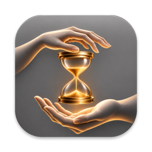

<div align="center">



# TaskJinn

**A lightweight desktop time tracker with a task board, for macOS, Windows and Linux.**

Organize work into organizations → projects → tasks, track time with start / pause / stop timers,
and keep every organization's data in a local folder you choose.

[](LICENSE)


</div>

---

## Contents

- [Features](#features)
- [How it works](#how-it-works)
- [Tools required](#tools-required)
- [Setup](#setup)
  - [macOS](#macos)
  - [Windows](#windows)
  - [Linux](#linux)
- [Development](#development)
- [Project structure](#project-structure)
- [Your data](#your-data)
- [Troubleshooting](#troubleshooting)
- [Contributing](#contributing)
- [License](#license)

## Features

- **Organizations → Projects → Tasks.** Each project key (e.g. `WEB`) numbers its tasks `WEB-1`, `WEB-2`, …
- **Task board.** To Do, In Progress, In Review and Done columns. Drag a card to change its status.
- **Timers.** ▶ start, ❚❚ pause, ■ stop (moves the task to Done). Several tasks can run at once. Every start → pause/stop is saved as a session, so time is always worked out from real sessions.
- **Status history.** Every status change is recorded with its time, so each task shows the time spent in each status, when it was first started and completed, and how long it took from creation to done.
- **Rich text** descriptions and comments: headings, bold and italic, lists, checklists, quotes, code, links and pasted images.
- **Task details:** type (Task / Bug / Story), priority, labels, due date, estimate (with % used), and subtasks with their own To Do / In Progress / Done status.
- **Menu bar / tray timer.** Click the tray icon for the tasks in progress, with pause, resume and stop. On macOS the running time shows next to the icon.
- **Timesheets and invoices.** Generate a timesheet or an invoice for an organization as an Excel (`.xlsx`) file, for a weekly, bi-weekly or monthly pay period. Hours come from your tracked time; the invoice adds your rate, tax and signature.
- **Local-first storage.** Each organization is a folder with a SQLite database and its images. Keep it in Dropbox or iCloud, back it up, or open it on another computer.

## How it works

TaskJinn is built with [Tauri 2](https://tauri.app). The app is plain HTML, CSS and JavaScript (Vue 3 and Quill, included as single files), so there's **no npm and no JavaScript build step**. A small Rust layer gives the pages access to SQLite, files, folder pickers and the tray icon.

The app uses the system's own web engine, so installers are small (about 6 MB on macOS):

| System | Web engine |
|---|---|
| macOS | WebKit (WKWebView) |
| Windows | Microsoft Edge WebView2 |
| Linux | WebKitGTK |

## Tools required

You need **Rust** to build TaskJinn, but you don't need to write any Rust. Everything else is listed per platform below.

| Tool | Why | macOS | Windows | Linux |
|---|---|:-:|:-:|:-:|
| [Git](https://git-scm.com) | Clone the repository | ✓ | ✓ | ✓ |
| [Rust](https://rustup.rs) (stable, via rustup) | Compiles the native part | ✓ | ✓ | ✓ |
| Tauri CLI 2 | Builds the installers. **Installed automatically** by the build scripts on first run | ✓ | ✓ | ✓ |
| Xcode Command Line Tools | C compiler and macOS SDK | ✓ | | |
| Microsoft C++ Build Tools | C++ compiler and Windows SDK | | ✓ | |
| WebView2 Runtime | Web engine (already part of Windows 10 and 11) | | ✓ | |
| WebKitGTK 4.1 and other system libraries | Web engine, tray icon | | | ✓ |

The first build downloads and compiles the dependencies, which takes a few minutes. Later builds take about a minute.

## Setup

Each system's installer is built on that system.

### macOS

**Requirements:** macOS 10.15 or later, on Apple silicon or Intel.

1. Install the Xcode Command Line Tools (skip this if `xcode-select -p` already prints a path):

   ```bash
   xcode-select --install
   ```

2. Install Rust, then open a new terminal so it's on your `PATH`:

   ```bash
   curl --proto '=https' --tlsv1.2 -sSf https://sh.rustup.rs | sh
   ```

3. Clone the repository:

   ```bash
   git clone https://github.com/ctrlshifti-ai/TaskJinn.git
   ```

   ```bash
   cd TaskJinn
   ```

4. Build the disk image:

   ```bash
   ./scripts/build-mac.sh
   ```

   To build one app for both Apple silicon and Intel Macs instead:

   ```bash
   ./scripts/build-mac.sh universal
   ```

5. Open `dist/TaskJinn_<version>_<arch>.dmg` and drag **TaskJinn** to **Applications**.

### Windows

**Requirements:** Windows 10 or 11, 64-bit.

1. Install the **Microsoft C++ Build Tools** from [visualstudio.microsoft.com/visual-cpp-build-tools](https://visualstudio.microsoft.com/visual-cpp-build-tools/). In the installer, select **Desktop development with C++**.
2. Install Rust: download and run `rustup-init.exe` from [rustup.rs](https://rustup.rs) and keep the default (MSVC) settings.
3. WebView2 is already part of Windows 10 (version 1803 and later) and Windows 11. On older systems, install the *Evergreen Bootstrapper* from [Microsoft](https://developer.microsoft.com/microsoft-edge/webview2/).
4. Open a **new** PowerShell window and clone the repository:

   ```powershell
   git clone https://github.com/ctrlshifti-ai/TaskJinn.git
   cd TaskJinn
   ```

5. Build the installers:

   ```powershell
   powershell -ExecutionPolicy Bypass -File scripts\build-windows.ps1
   ```

6. Run `dist\TaskJinn_<version>_x64-setup.exe`, or use the `.msi` in the same folder.

### Linux

**Requirements:** a 64-bit desktop Linux with WebKitGTK 4.1, such as Ubuntu 22.04+, Debian 12+, Fedora 38+ or Arch.

1. Install the system libraries for your distribution:

   **Debian / Ubuntu**

   ```bash
   sudo apt update
   sudo apt install build-essential curl wget file pkg-config libwebkit2gtk-4.1-dev libxdo-dev libssl-dev libayatana-appindicator3-dev librsvg2-dev
   ```

   **Fedora**

   ```bash
   sudo dnf group install "c-development"
   sudo dnf install webkit2gtk4.1-devel openssl-devel curl wget file libappindicator-gtk3-devel librsvg2-devel libxdo-devel
   ```

   **Arch**

   ```bash
   sudo pacman -S --needed webkit2gtk-4.1 base-devel curl wget file openssl appmenu-gtk-module libappindicator-gtk3 librsvg xdotool
   ```

   Other distributions: see Tauri's [Linux prerequisites](https://v2.tauri.app/start/prerequisites/#linux).

2. Install Rust, then open a new terminal:

   ```bash
   curl --proto '=https' --tlsv1.2 -sSf https://sh.rustup.rs | sh
   ```

3. Clone the repository:

   ```bash
   git clone https://github.com/ctrlshifti-ai/TaskJinn.git
   ```

   ```bash
   cd TaskJinn
   ```

4. Build the packages:

   ```bash
   ./scripts/build-linux.sh
   ```

5. Install one of the outputs from `dist/`:

   - **.deb** (Debian / Ubuntu):

     ```bash
     sudo apt install ./dist/TaskJinn_*_amd64.deb
     ```

   - **.AppImage** (any distribution): make it executable and run it:

     ```bash
     chmod +x dist/TaskJinn_*_amd64.AppImage
     ```

     ```bash
     ./dist/TaskJinn_*_amd64.AppImage
     ```

## Development

Run the app straight from the source, without making an installer. After the first build, restarting picks up any changes to the files in `app/`.

| System | Command |
|---|---|
| macOS / Linux | `./scripts/dev.sh` |
| Windows | `cargo tauri dev` |

Build script summary:

| Script | Output in `dist/` |
|---|---|
| `scripts/build-mac.sh [universal]` | `.dmg` |
| `scripts/build-windows.ps1` | setup `.exe`, `.msi` |
| `scripts/build-linux.sh` | `.AppImage`, `.deb` |

## Project structure

```
TaskJinn/
├── app/                    The app (HTML, CSS, JavaScript)
│   ├── index.html          Main window
│   ├── popup.html          Tray popup
│   ├── css/app.css         Styles (light and dark)
│   ├── js/
│   │   ├── store.js        All data and every change to it
│   │   ├── schema.js       Database tables
│   │   ├── main.js         Main window: organizations, projects, dialogs
│   │   ├── board.js        Project board with drag and drop
│   │   ├── taskpage.js     Task page: description, subtasks, comments, history
│   │   ├── richtext.js     Rich text editor (Quill)
│   │   ├── billing.js      Timesheet & invoice settings, pay periods, hours per day
│   │   ├── reports.js      Timesheet and invoice spreadsheet layouts
│   │   ├── billing-dialogs.js  Settings and Generate dialogs
│   │   ├── popup.js        Tray popup
│   │   ├── api.js          Calls into the native part
│   │   └── util.js         Shared helpers
│   └── lib/                Vue and Quill (unchanged, see THIRD_PARTY_NOTICES.md)
├── src-tauri/              Native part (Rust)
│   ├── src/database.rs     SQLite queries for the app
│   ├── src/files.rs        Files, folders, folder picker, image serving
│   ├── src/tray.rs         Tray icon, menu and popup window
│   ├── src/spreadsheet.rs  Writes .xlsx files described by reports.js
│   ├── tauri.conf.json     App name, windows and installer settings
│   └── icons/              App and tray icons
└── scripts/                Build and run scripts
```

## Your data

You choose a folder for each organization. Its data lives only there:

```
My Organization/
├── taskjinn.sqlite     projects, tasks, subtasks, time sessions, status history, comments
├── attachments/        images used in descriptions and comments
├── settings.json       timesheet and invoice details (you, the client, rate, pay period)
├── signature.png       your signature, shown on timesheets and invoices
├── Timesheets/         generated timesheets (.xlsx)
└── Invoices/           generated invoices (.xlsx)
```

- **No account and no cloud.** Nothing leaves your computer unless you put the folder in a synced location.
- **Back up or move** an organization by copying its folder. Use **Open Existing…** to add it on another computer.
- **Projects and tasks can't be added** until an organization has a folder.
- The app keeps only a list of your organizations and their folders, in `organizations.json`:

  | System | Location |
  |---|---|
  | macOS | `~/Library/Application Support/org.taskjinn.desktop/` |
  | Windows | `%APPDATA%\org.taskjinn.desktop\` |
  | Linux | `~/.local/share/org.taskjinn.desktop/` |

The database tables are defined in [`app/js/schema.js`](app/js/schema.js).

## Troubleshooting

**macOS says the app "can't be opened" or "is damaged".** Builds aren't signed with an Apple Developer ID, so macOS blocks copies that were downloaded. Open **System Settings → Privacy & Security** and click **Open Anyway**, or clear the download flag:

```bash
xattr -dr com.apple.quarantine /Applications/TaskJinn.app
```

**Windows SmartScreen warns about an unknown publisher.** The installer isn't code-signed. Click **More info → Run anyway**.

**The `.msi` build fails on Windows 11.** The MSI tools need the *VBSCRIPT* optional feature. Turn it on under **Settings → System → Optional features**, or build only the `.exe` installer with `cargo tauri build --bundles nsis`.

**No tray icon on GNOME (Linux).** GNOME hides tray icons by default. Install the *AppIndicator and KStatusNotifierItem Support* extension. On Linux the tray shows a menu (in-progress tasks with Pause / Resume / Stop) instead of the popup window.

**`cargo` not found right after installing Rust.** Open a new terminal, or run `source "$HOME/.cargo/env"`.

## Contributing

Issues and pull requests are welcome.

- Keep code simple and readable: plain logic, clear names, small functions, and short comments where something isn't obvious.
- No npm or JavaScript build step. Add any libraries as single files under `app/lib/`.
- App logic belongs in JavaScript (`app/js`). Only add Rust for things a web page can't do.
- If you change the database tables, add an upgrade step in `prepareDatabase()` in `app/js/schema.js` and raise `LATEST_VERSION`.

## License

Copyright (C) 2026 TaskJinn contributors.

TaskJinn is free software: you can redistribute it and/or modify it under the terms of the
[GNU General Public License](LICENSE) as published by the Free Software Foundation, either
version 3 of the License, or (at your option) any later version. It is distributed WITHOUT ANY
WARRANTY; see the license for details.

Third-party parts keep their own (GPL-compatible) licenses, listed in
[THIRD_PARTY_NOTICES.md](THIRD_PARTY_NOTICES.md).
